# Design Pattern Research Intelligence Platform
## End-to-end workflow: PDFs + datasets → harvesting → knowledge engineering → analysis → Next.js

The platform is specialized for a corpus of **design-pattern research papers**. Its goal is to extract, connect, compare, and visualize evidence about patterns: the problems they address, their structure and collaborations, implementation variants, tradeoffs, empirical evaluations, and evolution over time.

```mermaid
stateDiagram-v2
    direction TB

    [*] --> Inputs

    state "INPUTS: DESIGN PATTERN CORPUS" as Inputs {
        [*] --> Papers
        state "Design Pattern Research Papers (PDFs)" as Papers
        state "Structured Data: CSV / JSON / BibTeX / XML" as Datasets
        state "DOI / References / Authors / Publication Metadata" as Metadata
        state "Code Examples / Repositories / UML Diagrams / Evaluation Data" as Artifacts
        Papers --> [*]
        Datasets --> [*]
        Metadata --> [*]
        Artifacts --> [*]
    }

    Inputs --> Harvesting

    state "1. DESIGN PATTERN PAPER HARVESTING" as Harvesting {
        [*] --> Ingest
        state "Ingest Papers, Metadata and Supporting Artifacts" as Ingest
        state "Extract Text, Sections, Tables, Figures and Captions" as Parse
        state "Identify Pattern Name, Aliases and Pattern Family" as Identity
        state "Extract Intent, Context and Recurring Problem" as Problem
        state "Extract Applicability, Forces and Preconditions" as Applicability
        state "Extract Participants, Responsibilities and Collaborations" as Structure
        state "Extract UML / Class / Sequence / Interaction Details" as Diagrams
        state "Extract Solution, Implementation and Code Examples" as Implementation
        state "Extract Consequences, Benefits and Liabilities" as Consequences
        state "Extract Variants, Related Patterns and Alternatives" as Variants
        state "Extract Limitations, Misuse and Anti-Patterns" as Limitations
        state "Extract Empirical Results, Metrics and Evaluation Context" as Evaluation
        state "Capture DOI, Page, Quote / Evidence Span and Source Link" as Evidence
        state "Validate Fields and Mark Missing or Uncertain Data" as Validate

        Ingest --> Parse
        Parse --> Identity
        Identity --> Problem
        Problem --> Applicability
        Applicability --> Structure
        Structure --> Diagrams
        Diagrams --> Implementation
        Implementation --> Consequences
        Consequences --> Variants
        Variants --> Limitations
        Limitations --> Evaluation
        Evaluation --> Evidence
        Evidence --> Validate
        Validate --> [*]
    }

    Harvesting --> PatternKnowledge

    state "2. DESIGN PATTERN KNOWLEDGE ENGINEERING" as PatternKnowledge {
        [*] --> Normalize
        state "Normalize Pattern Names, Synonyms and Terminology" as Normalize
        state "Classify Pattern Type and Scope" as Classification
        state "Build Pattern Problem / Intent Taxonomy" as ProblemTaxonomy
        state "Model Participants, Roles and Collaborations" as Roles
        state "Model Applicability, Forces and Constraints" as Forces
        state "Model Consequences and Tradeoffs" as Tradeoffs
        state "Connect Patterns to Variants, Alternatives and Related Patterns" as Relations
        state "Link Pattern Claims to Papers, Code and Evidence" as Provenance
        state "Resolve Duplicates, Aliases and Conflicting Definitions" as Resolution
        state "Build Design Pattern Knowledge Graph" as Graph
        state "Validate Consistency, Confidence and Source Traceability" as Validation
        state "Publish Versioned Pattern Knowledge Base" as KnowledgeBase

        Normalize --> Classification
        Classification --> ProblemTaxonomy
        ProblemTaxonomy --> Roles
        Roles --> Forces
        Forces --> Tradeoffs
        Tradeoffs --> Relations
        Relations --> Provenance
        Provenance --> Resolution
        Resolution --> Graph
        Graph --> Validation
        Validation --> KnowledgeBase
        Validation --> Normalize: Conflicting name / definition / category
        KnowledgeBase --> [*]
    }

    PatternKnowledge --> PatternAnalytics

    state "3. DESIGN PATTERN RESEARCH ANALYTICS" as PatternAnalytics {
        [*] --> Timeline
        state "Year-by-Year Publication and Research Trends" as Timeline
        state "Evolution of Pattern Definitions and Intent" as DefinitionEvolution
        state "Evolution of Pattern Variants and Implementations" as VariantEvolution
        state "Problem–Pattern–Consequence Matrix" as Matrix
        state "Compare Patterns Addressing Similar Problems" as Alternatives
        state "Analyze Pattern Families, Scope and Classification" as Families
        state "Analyze Language, Paradigm and Platform Applicability" as Language
        state "Analyze Reported Benefits, Liabilities and Tradeoffs" as Tradeoffs
        state "Analyze Adoption and Usage Evidence" as Adoption
        state "Compare Empirical Methods, Datasets and Metrics" as Evaluation
        state "Detect Conflicts, Evidence Gaps and Understudied Patterns" as Gaps

        Timeline --> DefinitionEvolution
        DefinitionEvolution --> VariantEvolution
        VariantEvolution --> Matrix
        Matrix --> Alternatives
        Alternatives --> Families
        Families --> Language
        Language --> Tradeoffs
        Tradeoffs --> Adoption
        Adoption --> Evaluation
        Evaluation --> Gaps
        Gaps --> [*]
    }

    PatternAnalytics --> Reasoning

    state "4. EVIDENCE-BASED PATTERN REASONING" as Reasoning {
        [*] --> CrossPaper
        state "Connect Pattern Findings Across Papers and Years" as CrossPaper
        state "Compare Patterns Under Similar Contexts and Constraints" as Compare
        state "Separate Theoretical Claims from Empirical Findings" as EvidenceType
        state "Identify Repeatedly Reported Benefits and Liabilities" as Findings
        state "Track Whether Earlier Limitations Were Addressed Later" as FollowUp
        state "Identify Conflicting Results and Context-Dependent Outcomes" as Conflicts
        state "Identify Missing Evaluations and Open Research Questions" as Gaps
        state "Generate Evidence-Linked Research Hypotheses" as Hypotheses

        CrossPaper --> Compare
        Compare --> EvidenceType
        EvidenceType --> Findings
        Findings --> FollowUp
        FollowUp --> Conflicts
        Conflicts --> Gaps
        Gaps --> Hypotheses
        Hypotheses --> [*]
    }

    Reasoning --> PracticeMapping

    state "5. RESEARCH-TO-PRACTICE MAPPING" as PracticeMapping {
        [*] --> Research
        state "Map Pattern Descriptions to Real Software Use Cases" as Research
        state "Connect Papers to Implementations and Repositories" as Implementations
        state "Track Pattern Use Across Languages and Frameworks" as Ecosystem
        state "Compare Intended Benefits with Reported Practical Outcomes" as Outcomes
        state "Identify Adoption Barriers and Maintenance Costs" as Barriers
        state "Identify Misapplication, Overengineering and Anti-Patterns" as Misuse
        state "Separate Research Evidence from Anecdotal Usage Claims" as Evidence

        Research --> Implementations
        Implementations --> Ecosystem
        Ecosystem --> Outcomes
        Outcomes --> Barriers
        Barriers --> Misuse
        Misuse --> Evidence
        Evidence --> [*]
    }

    PracticeMapping --> PatternLab

    state "6. INTERACTIVE DESIGN PATTERN LAB" as PatternLab {
        [*] --> Select
        state "Select a Pattern and a Concrete Problem Scenario" as Select
        state "Define Context, Requirements and Constraints" as Scenario
        state "Show Baseline Design Without the Pattern" as Baseline
        state "Show Pattern Participants and Collaborations" as Structure
        state "Explore Reference Implementation and Variants" as Variants
        state "Compare Alternative Patterns or Direct Implementation" as Alternatives
        state "Visualize Class, Sequence and Interaction Flow" as Visualization
        state "Run Available Code Examples or Explicit Demonstrations" as Run
        state "Compare Complexity, Coupling, Extensibility and Other Outcomes" as Outcomes
        state "Record Assumptions, Limitations and Source Evidence" as Evidence

        Select --> Scenario
        Scenario --> Baseline
        Baseline --> Structure
        Structure --> Variants
        Variants --> Alternatives
        Alternatives --> Visualization
        Visualization --> Run
        Run --> Outcomes
        Outcomes --> Evidence
        Evidence --> [*]
    }

    PatternLab --> NextJS

    state "7. NEXT.JS DESIGN PATTERN RESEARCH PORTAL" as NextJS {
        [*] --> Dashboard
        state "Research Dashboard and Corpus Statistics" as Dashboard
        state "Corpus Explorer: Papers, Authors, Venues and Years" as Corpus
        state "Pattern Catalog and Pattern Detail Pages" as Catalog
        state "Pattern Evolution Timeline" as TimelineUI
        state "Problem–Pattern–Consequence Matrix" as MatrixUI
        state "Pattern Family and Classification Explorer" as FamilyUI
        state "Pattern Relationship Knowledge Graph" as GraphUI
        state "Implementation and Language Comparison" as CodeUI
        state "Benefits, Liabilities and Tradeoff Explorer" as TradeoffUI
        state "Evidence, Evaluation and Benchmark Explorer" as EvaluationUI
        state "Research Gap and Understudied Pattern Explorer" as GapsUI
        state "Pattern Adoption and Practice Explorer" as PracticeUI
        state "Interactive Design Pattern Lab" as LabUI
        state "Paper, Page-Level Evidence, DOI and Repository Links" as EvidenceUI
        state "Harvest Completeness and Provenance Audit" as AuditUI

        Dashboard --> Corpus
        Dashboard --> Catalog
        Dashboard --> TimelineUI
        Dashboard --> MatrixUI
        Dashboard --> FamilyUI
        Dashboard --> GraphUI
        Dashboard --> CodeUI
        Dashboard --> TradeoffUI
        Dashboard --> EvaluationUI
        Dashboard --> GapsUI
        Dashboard --> PracticeUI
        Dashboard --> LabUI
        Dashboard --> EvidenceUI
        Dashboard --> AuditUI

        Corpus --> [*]
        Catalog --> [*]
        TimelineUI --> [*]
        MatrixUI --> [*]
        FamilyUI --> [*]
        GraphUI --> [*]
        CodeUI --> [*]
        TradeoffUI --> [*]
        EvaluationUI --> [*]
        GapsUI --> [*]
        PracticeUI --> [*]
        LabUI --> [*]
        EvidenceUI --> [*]
        AuditUI --> [*]
    }

    NextJS --> Audit

    state "8. HARVESTING AND EVIDENCE AUDIT" as Audit {
        [*] --> Coverage
        state "Check Paper and Artifact Processing Coverage" as Coverage
        state "Verify Pattern Facts Against Source Pages" as FactCheck
        state "Validate DOI, Citations and Repository Links" as Links
        state "Audit Pattern Aliases, Duplicates and Relationships" as Duplicates
        state "Track Missing Fields, Confidence and Contradictions" as Confidence
        state "Distinguish Source Claims, Empirical Results and Inferences" as Claims
        state "Generate Corpus Quality and Traceability Report" as Report

        Coverage --> FactCheck
        FactCheck --> Links
        Links --> Duplicates
        Duplicates --> Confidence
        Confidence --> Claims
        Claims --> Report
        Report --> [*]
    }

    Audit --> ContinuousUpdate

    state "9. CONTINUOUS CORPUS AND KNOWLEDGE UPDATE" as ContinuousUpdate {
        [*] --> NewEvidence
        state "Add New Paper, Code Example or Evaluation Dataset" as NewEvidence
        state "Harvest New and Changed Sources" as Reharvest
        state "Update Pattern Taxonomy and Knowledge Graph" as UpdateGraph
        state "Recalculate Trends, Relationships and Research Gaps" as Recalculate
        state "Refresh Next.js Views and Audit Reports" as Refresh

        NewEvidence --> Reharvest
        Reharvest --> UpdateGraph
        UpdateGraph --> Recalculate
        Recalculate --> Refresh
        Refresh --> [*]
    }

    ContinuousUpdate --> Harvesting: New source
    ContinuousUpdate --> [*]: Current corpus analyzed
```

## What to harvest from every paper

Create a structured record for each pattern discussed, including:

- **Identity:** canonical name, aliases, first known/source citation where supported, pattern family, and scope.
- **Intent and problem:** the recurring design problem, context, forces, constraints, and motivation.
- **Applicability:** when the pattern is suitable, required conditions, and situations where it is not suitable.
- **Structure and behavior:** participants, roles, responsibilities, collaborations, class/sequence diagrams, and interaction flow.
- **Implementation:** pseudocode, code snippets, language, framework, implementation variants, and repository links when available.
- **Consequences:** stated benefits, liabilities, complexity, coupling, cohesion, extensibility, performance, testability, and maintenance implications where discussed.
- **Relationships:** alternatives, complementary patterns, related patterns, pattern combinations, variants, and anti-patterns.
- **Evaluation:** study design, participants or dataset, baseline, metrics, results, limitations, and reproducibility details.
- **Evidence and provenance:** paper ID, DOI, year, page/section, source excerpt, extraction confidence, and whether each statement is an author claim, measured result, or platform inference.
- **Research trajectory:** changes in definition, new variants, repeated criticisms, unresolved questions, and proposed future work.

Do not assume every paper contains all fields. Store absent or uncertain values explicitly rather than filling them with guesses.

## Pattern taxonomy

Use a flexible taxonomy rather than forcing every pattern into one category:

- **By intent or role:** creational, structural, behavioral, concurrency, integration, enterprise, UI, or other categories supported by the corpus.
- **By scope:** class-level, object-level, component-level, application-level, or system-level, where the source supports the distinction.
- **By abstraction:** idiom, design pattern, architectural pattern, or other level of abstraction.
- **By lifecycle:** proposed, refined, empirically evaluated, widely reported in practice, criticized, or superseded—only when evidence supports the status.
- **By evidence strength:** conceptual discussion, example implementation, controlled evaluation, observational study, systematic review, or production evidence.

These labels should be configurable. A paper's own classification should be preserved alongside any normalized platform classification.

## Core Next.js research views

| View | What it answers |
|---|---|
| Corpus Explorer | Which papers, authors, venues, years, code artifacts, and datasets are included? |
| Pattern Catalog | What is each pattern's intent, context, structure, behavior, and consequences? |
| Pattern Evolution | How have definitions, variants, and reported use changed over time? |
| Problem–Pattern Matrix | Which patterns address a given problem, and under what conditions? |
| Pattern Relationship Graph | Which patterns are alternatives, complements, variants, or commonly combined? |
| Implementation Explorer | How do implementations differ across languages, frameworks, and paradigms? |
| Tradeoff Explorer | What benefits and liabilities are reported, and in which contexts? |
| Evaluation Explorer | Which patterns have empirical evidence, and how comparable are the studies? |
| Research Gap Explorer | Which patterns or claims lack evidence, have conflicting results, or remain understudied? |
| Practice Explorer | What evidence exists for practical adoption, misuse, maintenance cost, or overengineering? |
| Interactive Pattern Lab | How does a pattern change the structure or collaboration in a concrete example? |
| Evidence Explorer | Which source page supports each definition, consequence, or evaluation claim? |
| Harvest Audit | Which papers or fields are incomplete, uncertain, duplicated, or inconsistent? |

## Key analysis questions

The platform should help users investigate questions such as:

1. Which design-pattern problems receive the most research attention in each year?
2. How have pattern definitions, implementations, and variants evolved?
3. Which different patterns attempt to solve the same problem?
4. What context and constraints explain why a pattern works well in one case but poorly in another?
5. Which claimed benefits and liabilities are supported by empirical evidence?
6. Which patterns are frequently discussed but weakly evaluated?
7. Which reported limitations persist across decades or reappear in new languages and frameworks?
8. Which patterns are combined, replaced, adapted, or criticized by later work?
9. Where do research papers disagree, and can differences be explained by context or evaluation method?
10. Which research questions could be tested through a reproducible implementation or study?

**Important implementation rule:** a pattern being mentioned in a paper does not prove it is effective, popular, or widely adopted. Preserve citations and source-page evidence; distinguish author claims, measured findings, practitioner reports, and platform-generated inferences. Interactive demonstrations should be labeled as educational examples unless they implement a reproducible evaluation.
